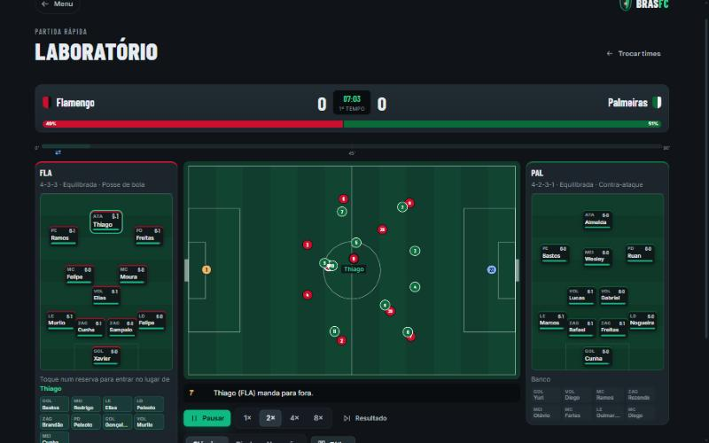
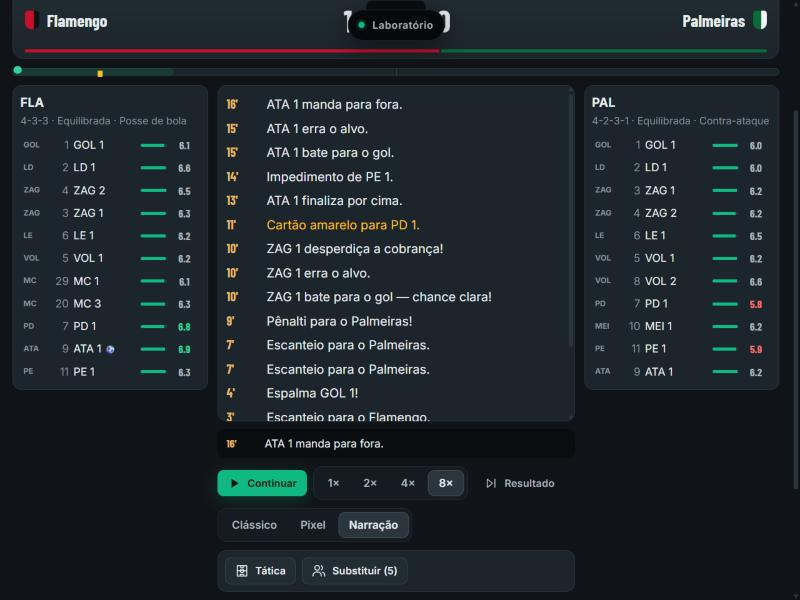
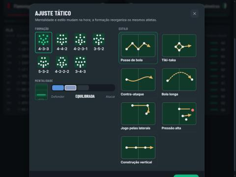
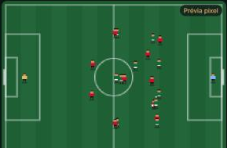
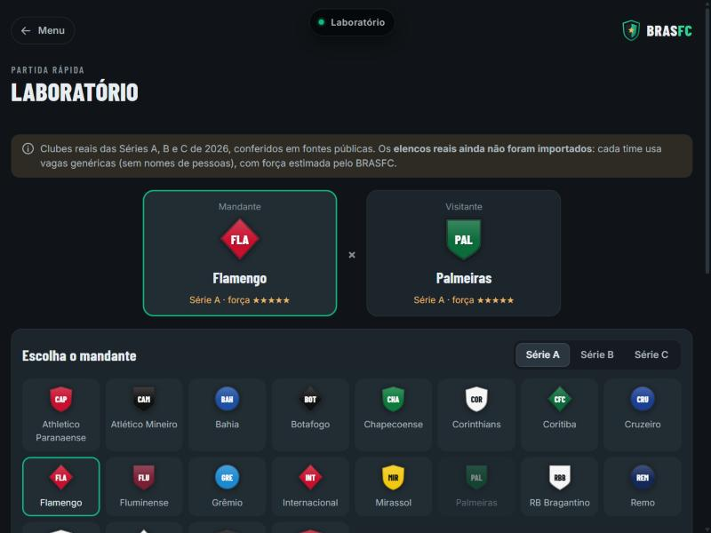
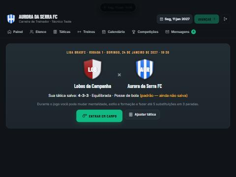
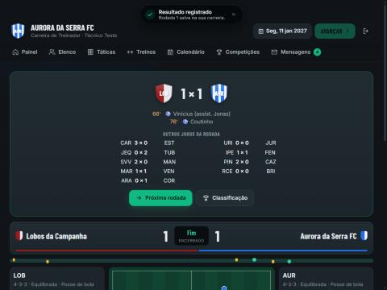
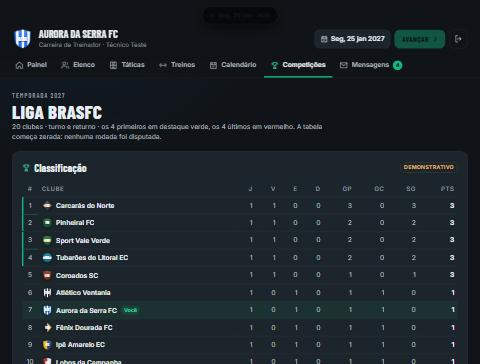

# BRASFC — Relatório da Dev 0.2

**Motor de futebol, partidas em 2D, Laboratório e base Brasil 2026**
Data: 17/11/2026 · Branch: `dev` · Versão do app: 0.2.0 · Versão do motor: 0.2.0

## 1. Resumo

| Item pedido | Situação |
|---|---|
| Auditoria e correção do salvamento de táticas | **Feito** — causa encontrada e corrigida, com teste de regressão |
| Motor de futebol próprio (2D, eventos, determinístico) | **Feito** |
| Atributos por categoria e overall ponderado por posição | **Feito** (27 atributos, 4 grupos) |
| 7 formações, 3 mentalidades, 7 estilos com efeito real | **Feito** — sem opção universalmente superior (medido) |
| Tela de partida 2D inspirada na referência | **Feito** — Clássico e Narração completos; Pixel é **prévia** |
| Velocidades, pausa, pular para o resultado sem alterar o placar | **Feito** e testado |
| Substituições com regras e mudanças táticas ao vivo | **Feito** (5 trocas, 3 paradas + intervalo) |
| Estatísticas a partir dos eventos, notas, linha do tempo | **Feito** |
| Clubes reais Séries A/B/C 2026 com fontes e pendências | **Parcial** — participantes conferidos; estádios, técnicos e elencos pendentes |
| Laboratório / Partida Rápida no menu | **Feito** |
| Carreira de treinador joga com a tática salva; resultado volta à carreira | **Feito** — reprodução autoritativa no servidor |
| Carreira de jogador com estatísticas individuais | **Parcial** — estatísticas por partida gravadas; acumulado da temporada ainda não exibido |
| Testes estatísticos, de determinismo e de persistência | **Feito** — 51 testes passando |
| Documentação e relatório | **Feito** (este documento, `docs/MOTOR.md`, `docs/DADOS.md`) |

## 2. Correção do salvamento de táticas

**Sintoma:** depois de salvar, a tela continuava com "Alterações não salvas".
**Causa:** o PostgreSQL guarda a tática em `jsonb`, que **reordena as chaves**. A tela comparava `JSON.stringify` do objeto inteiro, e a ordem diferente fazia a tática salva parecer diferente. Também era possível enviar uma versão antiga da carreira e receber conflito.
**Correção:** comparação por chave canônica (`tacticKey`/`sameTactic`), confirmação só depois que o servidor devolve a tática gravada, uso da versão mais recente e aviso claro em caso de conflito com outra aba. Táticas antigas (Dev 0.1) são convertidas para o novo vocabulário.
**Teste:** `tests/engine.test.ts › táticas salvas` e `tests/db.test.ts › partidas da carreira`.

## 3. BRASFC Football Engine

- Simulação por ticks de 1 segundo em campo de 105 × 68 m, com posição contínua dos 22 atletas e da bola.
- Decisões do portador por utilidade (finalizar, passar, profundidade, cruzar, driblar, conduzir, afastar), escolhidas com ruído controlado pelo atributo **decisões**.
- Regras: impedimento (no momento do passe), faltas, cartões (incluindo segundo amarelo), pênaltis, escanteios, laterais, tiros de meta, acréscimos pelas paralisações reais, lesões, cansaço, substituições.
- Treinador automático para o adversário (trocas por cansaço/lesão, ajuste de mentalidade conforme o placar).
- Fator casa e "forma do dia" (±7%): o mais forte vence mais, mas não sempre.
- Detalhes em `docs/MOTOR.md`.

### Calibração (160 partidas entre times de força média)

| Métrica | Motor | Futebol profissional |
|---|---|---|
| Gols por jogo | 2,26 | 2,3–2,7 |
| Finalizações por time | 12,5 (3,1 no alvo) | 11–14 |
| xG por time | 1,21 | 1,2–1,4 |
| Precisão de passe | 78,1% | 78–84% |
| Escanteios por jogo | 10,7 | 9–11 |
| Faltas por jogo | 17,7 | 20–28 |
| Empates | 32,5% | 25–30% |
| Vitórias do mandante | 44,4% | 45–50% |
| Tempo de simulação | ~110 ms/partida | — |

### Equilíbrio tático (contra Equilibrada + Posse de bola, mando alternado, 120 jogos cada)

| Opção | V | E | D | Gols pró–contra |
|---|---|---|---|---|
| Defensiva | 29 | 46 | 45 | 1,02–1,19 |
| Equilibrada | 42 | 44 | 34 | 1,32–1,18 |
| Ofensiva | 45 | 36 | 39 | 1,59–1,46 |
| Tiki-taka | 57 | 32 | 31 | 1,87–1,35 |
| Contra-ataque | 61 | 31 | 28 | 1,93–1,32 |
| Bola longa | 53 | 33 | 34 | 1,85–1,49 |
| Jogo pelos laterais | 51 | 38 | 31 | 1,83–1,38 |
| Pressão alta | 47 | 28 | 45 | 1,94–1,75 |
| Construção vertical | 57 | 34 | 29 | 1,99–1,35 |

Leitura honesta: cada opção tem contrapartida visível (a Defensiva sofre e marca menos; a Pressão alta marca e sofre mais). Contra a Posse de bola, os estilos mais verticais levam leve vantagem nesta amostra; a Posse de bola recebeu um ajuste depois desta medição e deve ser recalibrada na próxima etapa.

**Limitações conhecidas:** impedimentos um pouco acima do real (~6,8 por jogo); forte × fraco (5★ × 1★) vence ~90%.

## 4. Central da partida

- Placar, relógio com acréscimos, barra de posse com porcentagens e **linha do tempo** com ícones de gols, cartões e substituições no minuto em que aconteceram.
- **Os dois times desenhados na formação**, ao lado do campo: cada ficha junta **nome, posição, nota ao vivo e condição física** (com cartões, gols e lesão), no lugar onde o atleta joga. Nada de listas.
- Tocar numa ficha (ou no jogador no campo) destaca o atleta e mostra o nome dele no gramado.
- **Substituição em dois toques**: toque em quem sai e depois no reserva (fichas do banco logo abaixo da formação). A troca acontece na próxima bola parada.
- Campo 2D **Clássico**, **Pixel** (prévia em baixa resolução) e **Narração** (texto gerado só dos eventos).
- Comparativo de estatísticas em barras com as cores dos times (posse, finalizações, no alvo, xG, passes certos, desarmes, escanteios, faltas, impedimentos).
- Velocidades 1×, 2×, 4× e 8×, pausa (barra de espaço) e **pular para o resultado**: a velocidade só muda quantos segundos de jogo são processados por quadro.
- Ajuste de formação, mentalidade e estilo com seletores visuais; o assistente dá uma sugestão a partir do estado real (cansaço, lesão, placar, finalizações sofridas, expulsão).
- A Dynamic Island foi removida: confirmações e erros aparecem num aviso discreto no canto, que some sozinho.

## 5. Laboratório (Partida Rápida)

Novo item no menu. Permite escolher quaisquer dois dos 60 clubes das Séries A, B e C 2026 (escudos genéricos, sem marcas), definir a tática de cada um e escolher quem comandar ou só assistir. Mostra a semente para reprodução exata.

## 6. Carreira

- Botão **Comandar a partida / Ir para o jogo** no painel e a nova tela "Dia de jogo".
- O treinador joga com a **tática salva**; no modo jogador, o técnico (IA) escala o time e o atleta do usuário entra com estatísticas próprias.
- Ao final, o navegador envia **apenas as decisões do treinador**. O servidor recria a partida pela semente, reproduz, **simula os outros 9 jogos da rodada** e grava tudo numa transação (`career_matches`, migração `0002`). O placar enviado pelo cliente nunca é aceito.
- A classificação passa a ser calculada a partir dos resultados gravados e a data avança para o dia seguinte da rodada.

## 7. Base Brasil 2026

- `src/lib/data/brasil/2026/`: `temporada.json`, `clubes.json`, `identidade.json` (cores separadas dos dados esportivos, sem escudos), `fontes.json`, `correcoes.json`.
- Participantes conferidos em: MKT Esportivo (dez/2025), 90min (mar/2026), TNH1 (dez/2025), Itatiaia (nov/2025). Sem *scraping*.
- **Pendente:** estádio, técnico, nome oficial e elenco de todos os clubes; cidade de Barra, Caxias, Floresta, Maranhão e Ypiranga; cores de 23 clubes.
- Enquanto os elencos reais não são importados, os jogadores têm **nomes fictícios** (marcados como pendentes, com aviso na tela). A força (1–5) é estimativa própria do BRASFC, documentada.
- Validador (`validateDataset`) e correções com fonte obrigatória. Detalhes em `docs/DADOS.md`.

## 8. Testes

`npm test`: **51 testes passando** em 6 arquivos.

- **Determinismo:** mesma semente ⇒ partida idêntica; passo a passo = simulação direta; decisões reproduzidas pelo servidor geram exatamente os mesmos eventos.
- **Consistência:** nenhum evento após o apito final; expulsos não voltam; no máximo 5 substituições sem repetição; placar = gols nos eventos = estatísticas derivadas; notas entre 3 e 10.
- **Estatística:** médias de gols, finalizações, precisão de passe e empates dentro das faixas de futebol profissional (80 partidas); forte vence mais, mas não sempre.
- **Persistência:** tática salva sobrevive ao `jsonb`; rodada gravada, data avançada, classificação com 20 jogos e rodada repetida recusada.
- **Dados:** base válida (3 × 20 clubes com fonte), validador detecta erros, correções funcionam, elencos pendentes marcados como fictícios.

Também: `svelte-check` sem erros nem avisos; build de produção ok.

## 9. Preservado da Dev 0.1

Integração com a Ultra Motion X (transições, ilha, microinterações), carreiras existentes (nenhuma é apagada; táticas antigas são convertidas), multiplayer beta, detecção de atualização sem perder alterações, migrações versionadas, backups e implantação automática. Nenhuma credencial foi adicionada ao código.

## 10. Próximos passos sugeridos

1. Importar elencos reais verificados (com fonte por atleta) e completar estádios/técnicos.
2. Levar os clubes reais para a carreira (Séries A, B e C com acesso e rebaixamento).
3. Prévia Pixel com os bonecos completos e animação de corrida.
4. Estatísticas acumuladas da temporada e histórico de partidas na carreira de jogador.
5. Recalibrar a Posse de bola e o volume de impedimentos.
