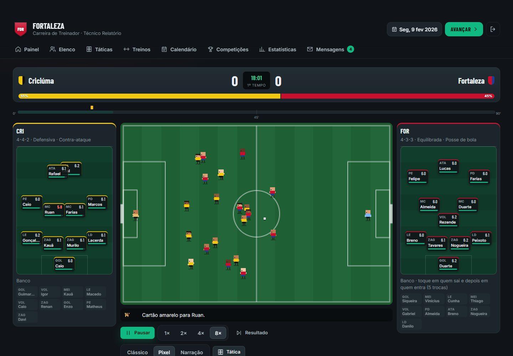
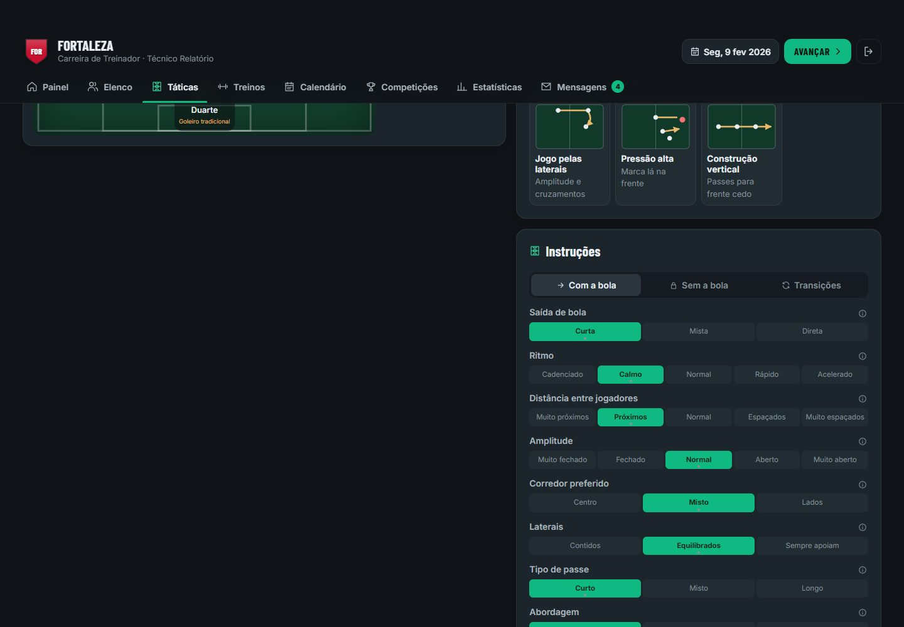
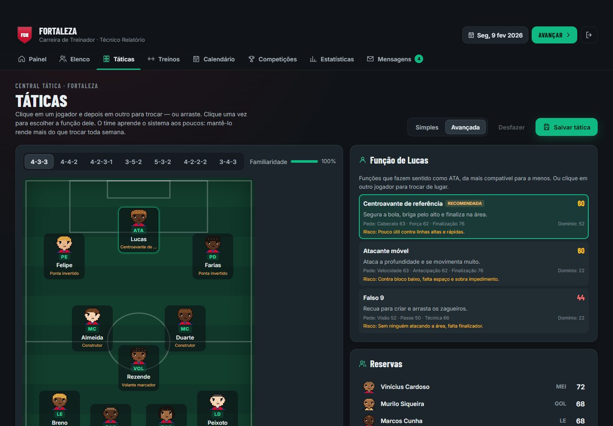
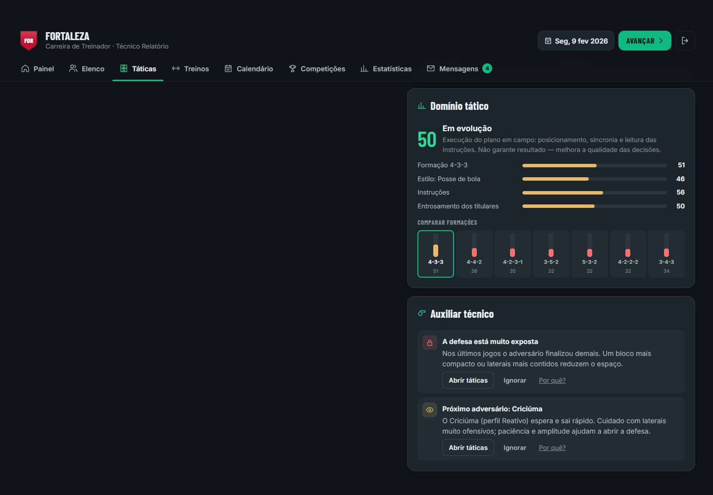
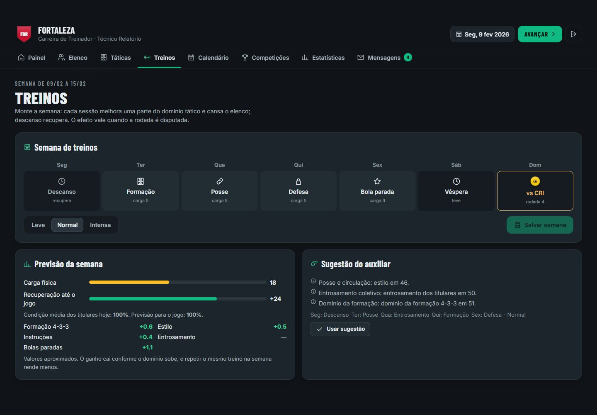
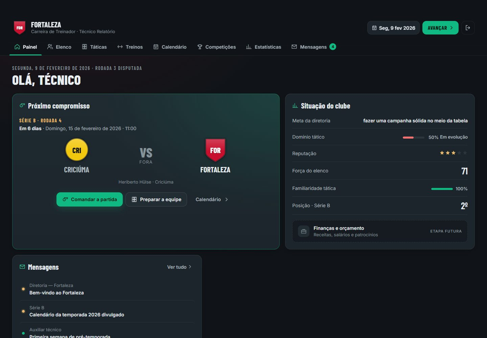
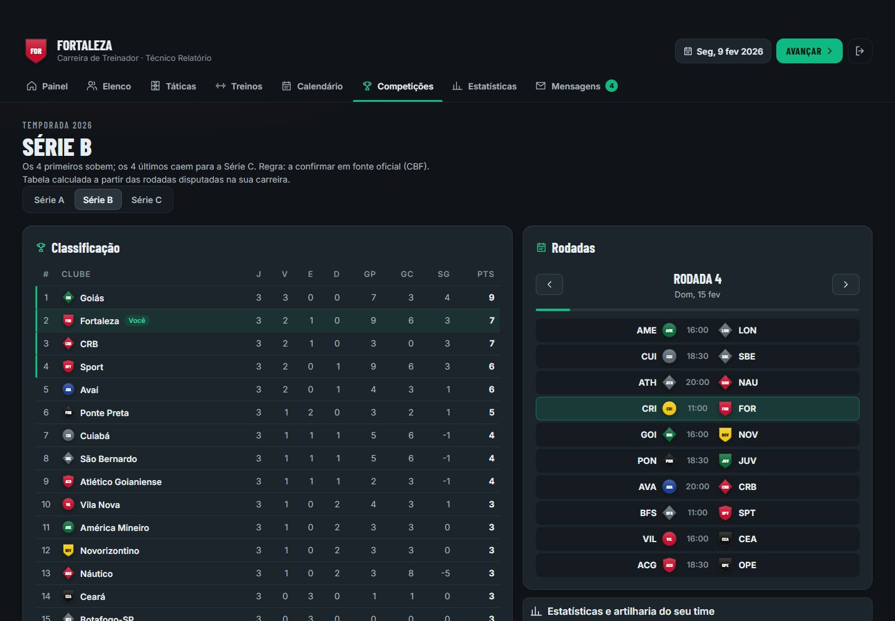

# BRASFC — Relatório da Dev 0.3

**Inteligência tática avançada, clubes reais nas carreiras e conclusão da Dev 0.2**
Data: 18/11/2026 · Branch: `dev` · Aplicativo 0.3.0 · Motor 0.3.0

## 1. Resumo em uma página

| Pedido | Situação |
|---|---|
| Corrigir e recalibrar o motor (impedimentos, faltas, gols, mando) | **Feito** |
| Equilibrar estilos e mentalidades | **Feito** — nenhum estilo vence todos |
| Equilibrar formações | **Melhorado** — o 4-3-3 ainda leva leve vantagem (limitação medida) |
| Modo Pixel completo | **Feito** |
| Estatísticas acumuladas do jogador | **Feito** |
| Base Brasil 2026 completa | **Parcial** — cidades, UF e estádios conferidos; técnicos, elencos, nomes oficiais e 23 cores **pendentes** (sem fonte confiável) |
| Editor tático simples e avançado | **Feito** |
| Domínio tático progressivo | **Feito** |
| Funções individuais | **Feito** (20 funções) |
| IA adversária que estuda e se adapta | **Feito** |
| Inteligência dos jogadores em campo | **Feito** |
| Centro de treinamento | **Feito** |
| Auxiliar técnico | **Feito** |
| Carreira de treinador e de jogador integradas | **Feito** |
| Séries A, B e C com acesso, rebaixamento e várias temporadas | **Feito** (regras de A e B a confirmar na CBF; Série D não simulada) |
| Testes, build e verificação de tipos | **Feito** — 74 testes passando, 0 erros |

## 2. O que foi corrigido da Dev 0.2

**Impedimentos (6,8 → 2,9 por jogo).** Não cortamos o evento. Corrigimos o comportamento:

- O atacante agora segura a linha e só "estica" quando o passe está para sair.
- Ele lê a linha de defesa que está subindo, e quem tem boa antecipação erra menos.
- Durante cobranças, ele também se posiciona em condição legal.
- O passador enxerga o impedimento: lances claros quase nunca são servidos, e os milimétricos enganam mais quem tem pouca visão.

**Outras calibrações**, comparadas com referências do Brasileirão:

| Métrica | Dev 0.2 | Dev 0.3 | Referência |
|---|---|---|---|
| Gols por jogo | 2,26 | 2,52 | 2,49 (Brasileirão 2025) |
| Finalizações por time | 12,5 | 12,6 | 11–14 |
| Passes certos | 78,1% | 78,8% | 78–84% |
| Faltas por jogo | 17,7 | 24,4 | 24,6 |
| Amarelos por jogo | 2,3 | 4,7 | 5–6 |
| Escanteios por jogo | 10,7 | 11,7 | 9,8 |
| Impedimentos por jogo | 6,8 | 2,9 | ~3 |
| Vitórias do mandante | 44% | 46,5% | 45–50% |

Fontes consultadas em 17/11/2026: Centauro (resumo do Brasileirão 2025), Soccerway (ranking de faltas do CIES), netvasco (cartões em 2024) e um estudo da UFU (escanteios). Para impedimentos, empates e mando não encontramos fonte nacional; esses valores usam faixas gerais do futebol.

**Estilos de jogo.** Antes, o Contra-ataque dominava e a Posse de bola ficava muito atrás. Agora todos ficam próximos:

| Estilo (pontos por jogo contra todos) | Dev 0.2 | Dev 0.3 |
|---|---|---|
| Posse de bola | 1,13 | 1,44 |
| Pressão alta | 1,33 | 1,39 |
| Bola longa | 1,49 | 1,34 |
| Jogo pelos laterais | 1,33 | 1,34 |
| Construção vertical | 1,53 | 1,33 |
| Contra-ataque | 1,84 | 1,32 |
| Tiki-taka | 1,51 | 1,26 |

Todo estilo tem um confronto difícil. Exemplos:

- A Pressão alta perde para a Construção vertical.
- O Tiki-taka sofre contra a Pressão alta.

As mentalidades também ficaram equilibradas: a Defensiva sofre menos e marca menos, e a Ofensiva marca mais e sofre mais.

**Formações.** Esquemas com dois atacantes quase não chutavam (cerca de 5 finalizações), e os de três zagueiros cediam até 22. Corrigimos o posicionamento:

- Os meias abertos sobem quando o time tem a bola.
- Os alas voltam e formam linha de 5 sem a bola.
- Os zagueiros guardam o centro.
- O segundo atacante passou a ser móvel.
- Os atacantes não ficam mais trocando passes infinitamente dentro da área.

Contra o 4-3-3, as demais formações agora fazem 0,90 a 1,18 ponto por jogo (antes, 0,38 a 0,55 nas piores). O 4-3-3 ainda leva leve vantagem; veja a seção 9.

**Também corrigido:**

- **Notas:** a média caiu de cerca de 7,8 para 6,5, e 90% dos jogadores ficam abaixo de 7,6.
- **Uniformes:** cores parecidas agora são resolvidas, e o visitante troca de uniforme.
- **Botão "Avançar":** agora funciona.

**Modo Pixel.** Os bonecos correm, caminham e mudam de direção conforme a velocidade real do motor. Eles chutam, dão carrinho, sobem para cabecear, e o goleiro se atira para defender. A bola ganha altura nos lançamentos, e aparecem cartões e a faixa de "GOOOL!". Tudo é **lido do motor**: não existe uma segunda simulação.

**Estatísticas acumuladas.** A nova página "Estatísticas" mostra jogos, titularidades, minutos, gols, assistências, chutes, passes, desarmes, cartões e nota média. Os dados aparecem por temporada e jogo a jogo, para o seu jogador e para o time. Tudo sai das partidas gravadas.

**Base Brasil 2026.** Conferimos cidade, UF e estádio dos 60 clubes nas tabelas da Wikipédia de cada série. Isso inclui as cidades antes pendentes: Barra-SC (Balneário Camboriú), Caxias (Caxias do Sul), Floresta (Fortaleza), Maranhão (São Luís) e Ypiranga (Erechim). O regulamento da Série C 2026 também foi conferido.

## 3. Como funciona a inteligência tática

**Dois níveis de tática.**
- **Simples:** formação, mentalidade e estilo. O jogo monta sozinho as 18 instruções avançadas a partir disso.
- **Avançada:** as 18 instruções, em três abas: *Com a bola*, *Sem a bola* e *Transições*. Cada uma traz uma explicação e um ponto dourado quando difere do padrão.

Trocar mentalidade ou estilo **não apaga** os seus ajustes avançados. A tela avisa quantos foram mantidos e oferece "Restaurar padrão".

Cada instrução muda o motor de verdade, sempre com um custo. Exemplos:

- **Pressão mais alta:** recupera a bola antes e cansa mais.
- **Ritmo acelerado:** chega antes à área e erra mais passes.
- **Marcação individual:** cola no adversário, mas é arrastada e abre espaços.

**Funções individuais.** Clique num jogador para ver as funções possíveis na posição dele. A tela mostra:

- a compatibilidade com os atributos dele;
- o motivo, ou seja, os atributos que a função exige;
- o risco da função;
- quanto ele já domina cada uma.

Exemplos: falso 9, ponta invertido, goleiro-líbero, área a área. A função muda onde ele se posiciona e o que ele prefere fazer com a bola. Fora da função ideal, o atleta decide pior.

**IA adversária.** Cada clube tem um técnico com um perfil de jogo (pragmático, ofensivo, reativo, posse, pressão alta, retranqueiro ou equilibrado). Como os técnicos reais ainda não foram cadastrados, o perfil não usa nome de pessoa.

- **Antes do jogo:** ele estuda o que *viu* nos seus três últimos jogos. Se você pressiona alto, ele sai jogando direto; se você se fecha, ele abre o campo; se seus laterais sobem muito, ele ataca os lados.
- **Durante o jogo:** a cada 5 minutos ele reage ao placar, ao cansaço, às expulsões, às finalizações e à altura da sua linha.

A IA não vê nada escondido nem ganha bônus. As decisões dela também são reproduzidas e conferidas pelo servidor.

**Jogadores mais inteligentes em campo:**

- desmarcação no tempo certo;
- coberturas organizadas pela formação;
- apoio de quem chega de trás;
- menos passes sem sentido.

Os atributos (visão, decisões, antecipação) mudam a **qualidade das escolhas**, não só a chance de acerto.

## 4. Domínio progressivo

O time aprende o seu sistema aos poucos. São cinco medidas de 0 a 100, salvas na carreira:

- formação;
- estilo;
- compreensão das instruções;
- entrosamento de cada atleta;
- domínio de cada atleta em cada função.

**Regras:**

- **Aprendizado lento:** três jogos não bastam. Uma temporada inteira mantendo o 4-3-3 leva o domínio para "Muito bom" (mais de 70).
- **Conhecimento aproveitado:** quem domina o 4-3-3 aprende o 4-2-3-1 mais rápido.
- **Esquecimento lento:** trocar de esquema não apaga o que o time já sabe.
- **Mudança de instruções:** derruba um pouco a compreensão, que volta com o tempo.
- **Contratados e jovens da base:** começam pouco entrosados.

O domínio melhora a **execução** (posicionamento, decisões e passes), **não** dá gols de graça. Medimos o mesmo time em 160 jogos contra um rival com domínio 60:

| Domínio | Vitórias | Empates | Derrotas |
|---|---|---|---|
| 35 | 44 | 47 | 69 |
| 60 | 48 | 62 | 50 |
| 85 | 58 | 56 | 46 |

Dominar o sistema ajuda bastante, mas o time não fica invencível.

## 5. Treinos e auxiliar técnico

**Centro de Treinamento.**

- **Semana:** cinco sessões (segunda a sexta), escolhidas entre 11 treinos: formação, posse, pressão alta, organização defensiva, contra-ataques, movimentações, construção, bolas paradas, entrosamento, funções e descanso.
- **Intensidade:** leve, normal ou intensa.
- **Previsão:** a tela mostra a carga física, quanto o elenco recupera até o jogo e o ganho aproximado em cada parte do domínio.
- **Sem atalho:** repetir o mesmo treino rende menos, e treino intenso cansa para o domingo.
- **Condição física:** fica salva para cada jogador.

**Auxiliar técnico.** Ele analisa:

- a formação que mais combina com o elenco;
- jogadores fora de posição;
- funções mais adequadas;
- falta de domínio do sistema;
- defesa exposta e ataque fraco nos últimos jogos;
- titulares cansados;
- o próximo adversário.

Cada recomendação mostra **os dados que a sustentam** (botão "Por quê?") e pode ser aplicada ou ignorada. Nenhuma mensagem é sorteada.

## 6. O que mudou nas carreiras

- **Clubes reais:** a nova carreira pode usar os 60 clubes de 2026. Os saves antigos continuam na liga fictícia, sem perder nada.
- **Calendário:** Séries A e B em turno e returno. Na Série C, a 1ª fase é em turno único, e depois vem uma 2ª fase com dois grupos de 4.
- **Rodadas sem jogo:** quando o seu time folga, basta avançar a semana.
- **Fim de temporada:** mostra a tabela final, os acessos e os rebaixamentos e começa a próxima temporada. A partir de 2027, as temporadas são projeções da sua carreira, não dados reais.
- **Rodada conferida pelo servidor:** ele reproduz a sua partida pela semente e pelas suas decisões, simula as três séries e grava tudo de uma vez. O placar enviado pelo navegador é ignorado.
- **Treinador:** tática salva com funções e instruções, mudanças durante o jogo, treinos, auxiliar e histórico por formação.
- **Jogador:** orientações do técnico (função esperada e compatibilidade), domínio das suas funções, titularidade definida pelo técnico da IA e estatísticas acumuladas.

**Temporada completa medida:** 974 partidas simuladas nas três séries, sem banco de dados.

- **Gols:** cerca de 3 por jogo.
- **Campeões:** Internacional (A), Náutico (B) e Confiança (C).
- **Acessos e rebaixamentos:** 8 acessos e 8 rebaixamentos, com 20 clubes por série na temporada seguinte.

## 7. Testes realizados

- `npm test`: **74 testes passando**, em 8 arquivos (eram 51).
- `npm run check`: **0 erros, 0 avisos**.
- `npm run build`: **ok**.

**O que os testes novos cobrem:**

- **Domínio progressivo:** evolução, troca de formação, mudança de elenco e mudança de instruções.
- **Funções e instruções:** compatibilidade de funções, efeito de cada instrução e preservação dos ajustes ao trocar o preset.
- **Treinos e recuperação.**
- **IA adversária:** adaptação durante o jogo e plano pré-jogo.
- **Decisões táticas:** mudanças durante o jogo reproduzidas evento a evento pelo servidor.
- **Temporada:** acesso e rebaixamento, com 20 clubes por série na seguinte.
- **Estatísticas acumuladas:** sem duplicação.
- **Integração com o banco:** rodada completa, tentativa de adulteração (decisões do lado da IA e versão antiga são recusadas), persistência do aprendizado e da condição física, e migração de save antigo.
- **Interface:** os componentes do editor tático são renderizados e verificados (seções, opção marcada, recomendação, riscos, explicações).
- **Dados:** cidades antes pendentes conferidas, e técnicos não inventados.

**Também verificado no navegador:** criar carreira com clube real, salvar tática avançada com função, jogar a rodada e registrar o resultado, modo Pixel e páginas novas.

**Desempenho:**

- **Partida:** cerca de 140–230 ms (varia com a carga da máquina).
- **Rodada completa (30 partidas):** cerca de 3,8 s em Node e cerca de 10 s no servidor de desenvolvimento.

## 8. Arquivos e migrações

- **Migração nova:** `migrations/0003_seasons_competitions.sql`, que adiciona temporada e competição aos resultados. A reversão manual está em `migrations/down/`.
- **Motor:**
  - `engine/instructions.ts`, `engine/roles.ts` e `engine/ai-coach.ts` (novos);
  - `engine/match.ts`, `stats.ts`, `tactics.ts` e `types.ts` (alterados).
- **Domínio da carreira:**
  - `domain/tactical.ts`, `drills.ts`, `league.ts`, `coaches.ts`, `assistant.ts` e `playerstats.ts` (novos);
  - `career.ts`, `matchday.ts`, `view.ts`, `tactics.ts` e `squad.ts` (alterados).
- **Servidor:** `server/rounds.ts` e a API `careers/[id]/season`.
- **Telas:**
  - táticas, treinos, competições, estatísticas (nova), dia de jogo, painel, nova carreira e central da partida;
  - componentes `InstructionsEditor`, `RolePicker`, `MasteryPanel` e `AssistantTips`.
- **Scripts de medição:** `engine-balance`, `engine-formations`, `engine-mastery`, `season-sim` e `capturas.mjs`.
- **Total:** 78 arquivos alterados (+5.447 / −685 linhas). Detalhes técnicos em `docs/MOTOR.md` e `docs/DADOS.md`.

## 9. O que continua pendente (limitações reais)

- **Elencos reais, técnicos, nomes oficiais e cores de 23 clubes.** Exigem conferência atleta a atleta e uma data de referência para os técnicos. As fontes consultadas listam várias trocas ao longo da temporada sem indicar com segurança "quem era o técnico no início". Nada foi inventado: o jogo usa jogadores com nomes fictícios, sinalizados, e perfis de técnico sem nome.
- **Regras das Séries A e B.** Os números de acesso e rebaixamento (4 e 4) ainda precisam ser confirmados no regulamento oficial da CBF. A Série D não é simulada: quem cairia da C permanece nela.
- **Formações.** O 4-3-3, base da calibração, ainda rende um pouco mais que as outras (1,45 ponto por jogo contra 0,90–1,18). Esquemas com três zagueiros cedem mais finalizações.
- **Jogos entre IAs.** Entre clubes reais com forças muito diferentes, a média fica perto de 3 gols, acima da média real.
- **Tempo de rodada.** Uma rodada leva alguns segundos, porque o servidor simula as três séries com o motor completo.
- **Ainda não existem:** Copa do Brasil e mercado de transferências.
- **Deploy.** A atualização automática da VPS está parada desde a versão `a55daf6`, e o site público ainda mostra a 0.1.0. É preciso rodar na VPS o comando de reinstalação da atualização automática (`self-update.sh --install`), descrito em `docs/DEPLOY.md`.
