# BRASFC 0.4 — Evolution Update

**Relatório da Dev 0.4** · 18/11/2026 · versão 0.4.0 · branch `dev`

## Visão geral
A 0.4 transforma o BRASFC num jogo de gerenciamento completo: Copa do Brasil, Série D, mercado de transferências, contratos, finanças, diretoria, patrocínios, estrutura, base, olheiros e história, tudo salvo no servidor e ligado à carreira. A interface foi refeita com painéis, gráficos, cartões e movimento da Ultra Motion X, e o jogo agora se atualiza por dentro, como um aplicativo instalável.

## Comparação com a 0.3
| | 0.3 | 0.4 |
|---|---|---|
| Competições | Séries A, B, C | Séries A–D + Copa do Brasil (126 clubes) |
| Clubes na base | 60 | 170 |
| Mercado | inexistente | compra, venda, empréstimo, livres, renovação, rescisão |
| Finanças | "etapa futura" | caixa, receitas, despesas, orçamento, projeção |
| Diretoria | meta em texto | 6 personalidades, objetivos, confiança, demissão |
| Base e olheiros | inexistente | turmas anuais, evolução, relatórios |
| Atualização | aviso de versão | Central de Atualizações + PWA instalável |
| Testes | 74 | 108 + 44 verificações no navegador |

## Telas novas e redesenhadas
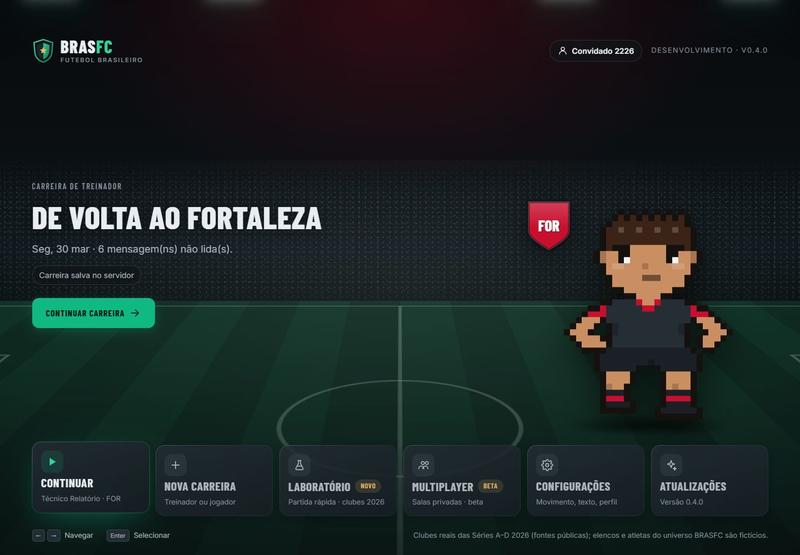
O menu deixou de ser uma coluna de botões: os modos viram cartões com profundidade e luz que segue o cursor.

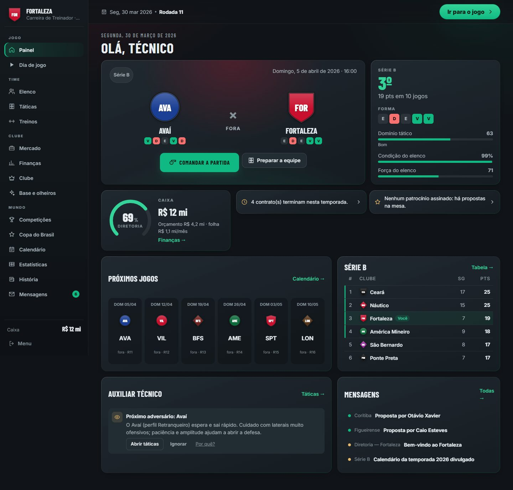
O painel destaca o próximo jogo (escudos, forma recente, mando), a situação, a diretoria, o caixa e alertas que levam direto à ação.

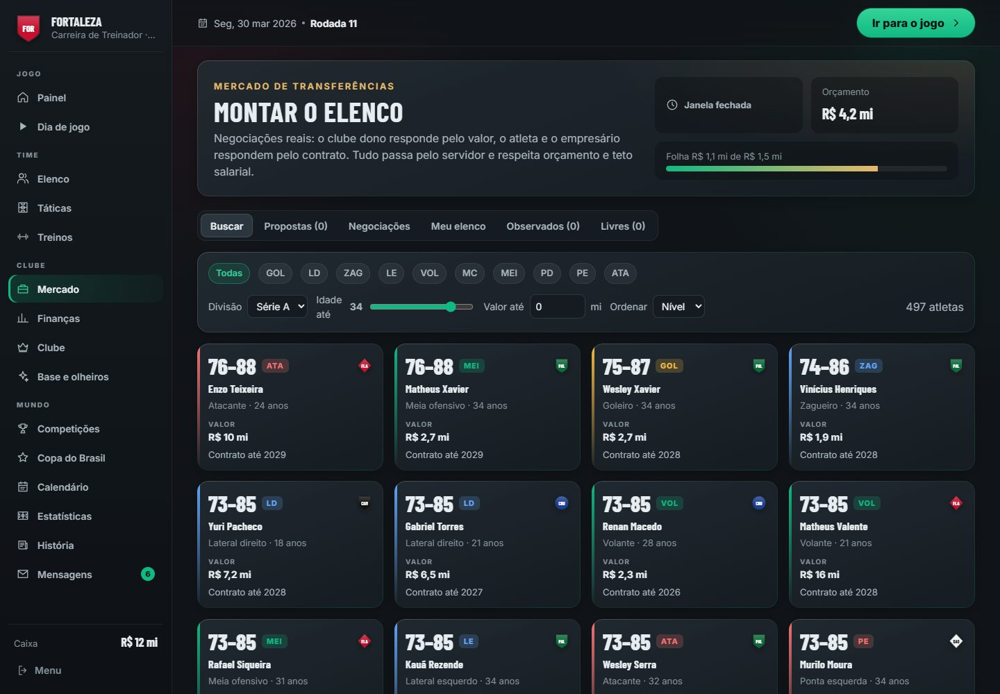
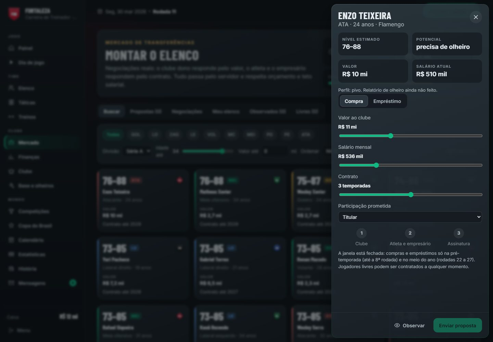
O mercado mostra cartões com nível **estimado** (sem revelar o real) e a negociação acontece num painel lateral em três etapas: clube, atleta/empresário e assinatura.

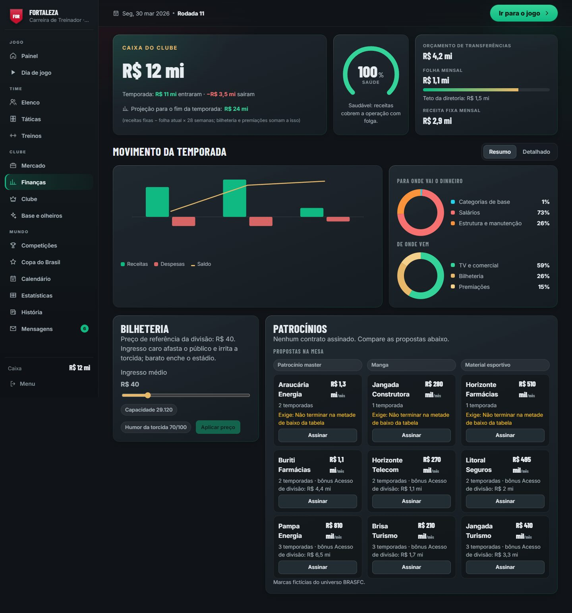
Finanças: saldo animado, medidor de saúde, receitas × despesas por mês, para onde vai o dinheiro, projeção, bilheteria e patrocínios por espaço.

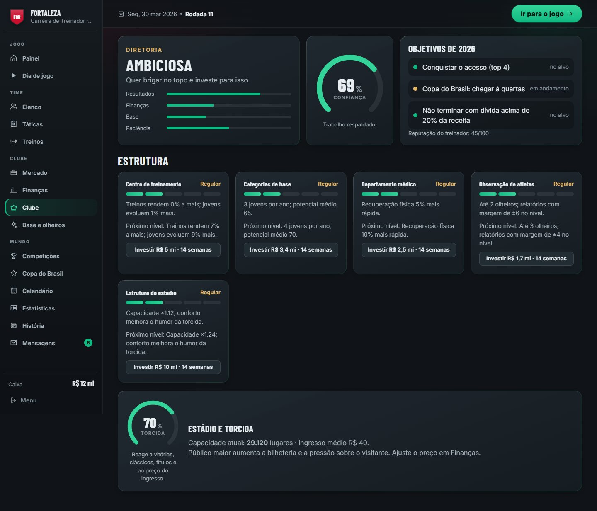
Diretoria com personalidade, confiança, objetivos, estrutura com obras e prazos, torcida e estádio.

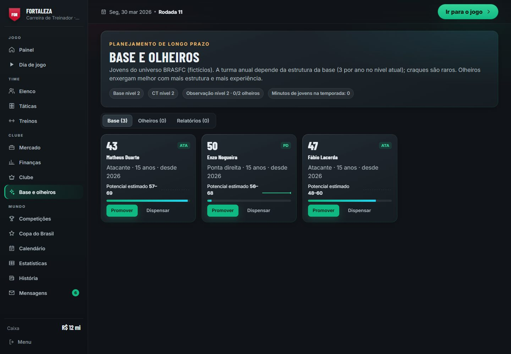
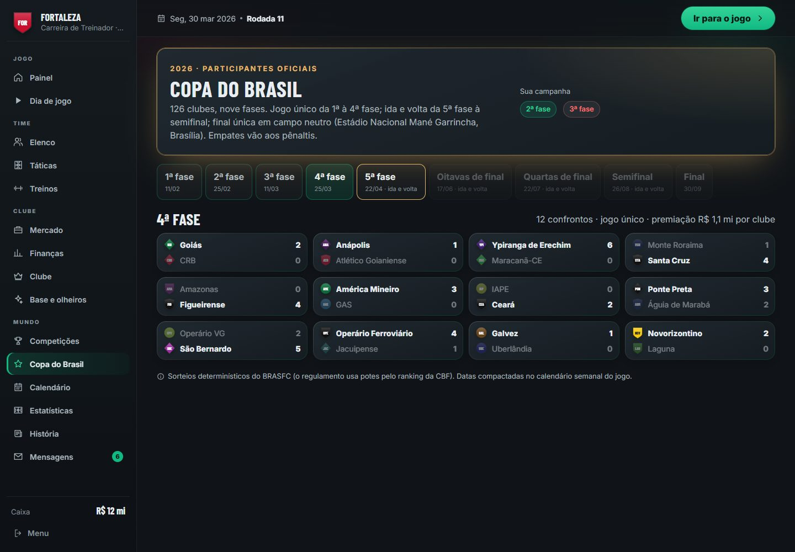
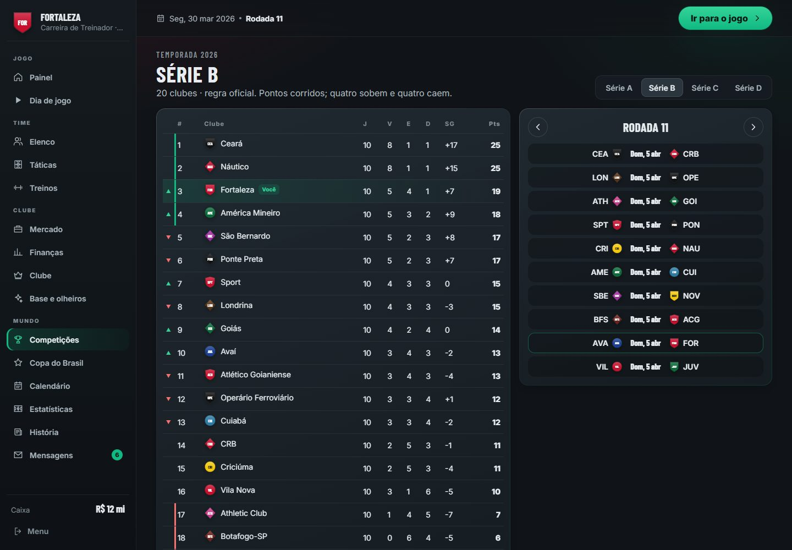
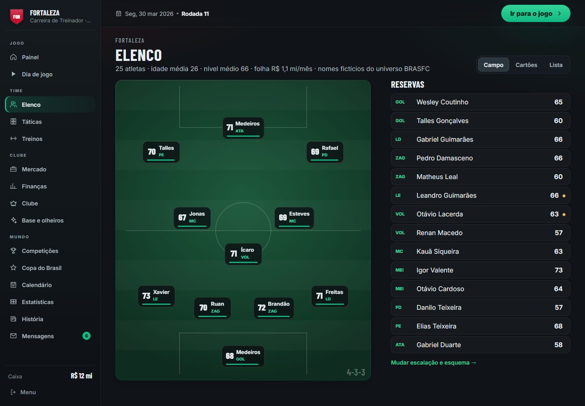
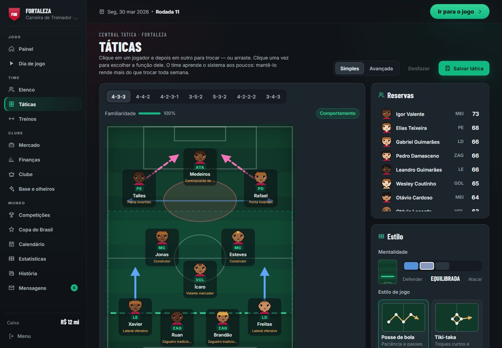
Na tática, o campo mostra o **comportamento** que o motor vai usar: linha defensiva, bloco, zona de pressão, amplitude e corridas de cada função. Mudar uma instrução muda o desenho.

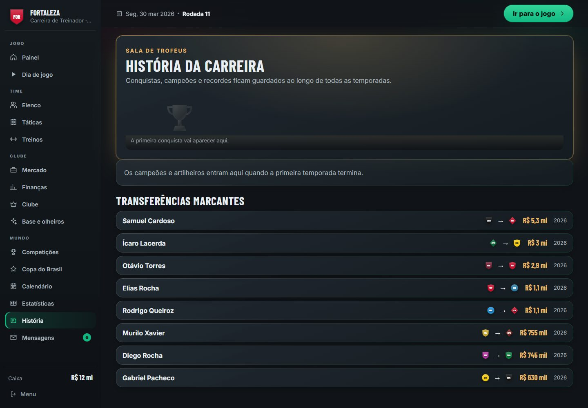
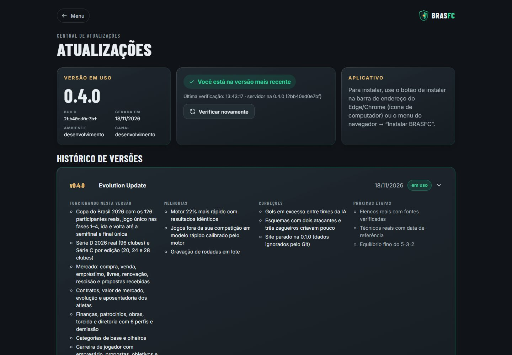

## Copa do Brasil
Edição 2026 com os 126 participantes reais e a fase de entrada de cada um (28 + 74 + 4 + 20). Jogo único da 1ª à 4ª fase, ida e volta da 5ª fase à semifinal, final única em campo neutro, pênaltis determinísticos, premiação por fase. A partida da Copa usa o mesmo motor da liga. As edições seguintes são projetadas a partir das divisões da carreira (sempre 126 clubes distintos).

## Mercado, contratos e finanças
- Cada atleta tem contrato (salário, término, participação) e valor de mercado. Um atleta nunca pertence a dois clubes.
- O clube vendedor responde pelo valor (mais caro se o atleta é peça-chave, mais barato se o clube está endividado); o atleta responde pelo salário, tempo e promessa de participação.
- A IA compra por carência de elenco e dentro do orçamento do seu nível; também faz propostas pelos seus atletas na janela.
- Orçamento de transferências e teto salarial impedem gastos impossíveis. O saldo final de uma temporada inteira bate com o saldo inicial mais todos os lançamentos (teste automático).

## Diretoria, patrocínios e estrutura
Seis perfis de diretoria (ambiciosa, conservadora, rígida, formadora, imediatista, projeto) avaliam resultados, finanças e base. Patrocinadores são marcas fictícias, com bônus por metas e exigências. Obras custam, levam semanas e só então sobem o nível; cada área tem efeito medido (treino, base, recuperação, olheiros, capacidade).

## Base e olheiros
Turmas anuais de 2 a 5 jovens fictícios; craques são raros e limitados. Os jovens evoluem semana a semana conforme CT, base e idade, e podem subir ao profissional. Olheiros trazem relatórios com faixas de nível e potencial, mais precisos com estrutura e experiência.

## Carreiras mais vivas
Treinador: propostas de emprego após demissão ou por destaque. Jogador: contrato, empresário com estilo próprio, propostas na janela conforme as notas, objetivos pessoais, prêmios e evolução que depende dos minutos jogados.

## Ultra Motion X
Integrada pelas APIs reais da biblioteca: material com luz e inclinação (`data-umx-surface`), atração magnética (`data-umx-magnet`), números animados (`number`), indicador líquido na navegação, molas nos painéis laterais, na abertura da Copa e na entrada em campo, partículas em conquistas. Ajuste de qualidade: **Automático, Completo, Leve** (Leve usa o perfil de desempenho); movimento reduzido do sistema é respeitado.

## Sistema de atualizações
- **PWA:** manifesto, ícones, janela própria, service worker com cache **separado por versão** (arquivos de versões diferentes nunca se misturam). Sem conexão, páginas visitadas abrem do cache; partidas e ações exigem o servidor.
- **Central de Atualizações:** versão em uso, estado real da verificação, novidades vindas do servidor, compatibilidade, "Atualizar agora" (bloqueado se houver alterações não salvas), confirmação de que a versão carregada é a esperada, aviso quando outra aba atualizou e tela "O que há de novo".
- **Servidor:** a VPS baixa a imagem publicada pelo GitHub em ≈3–4 minutos, com backup antes, verificação de saúde, retorno automático e registro do estado.

## Otimizações medidas
| | Antes | Depois |
|---|---|---|
| Partida no motor | 170 ms | 132 ms (resultados idênticos) |
| Passo de domingo (dev) | ≈10 s (30 jogos) | ≈1,9 s (≈130 jogos) |
| Quarta de Copa sem o usuário | — | ≈27 ms |
| Abertura das telas (DOMContentLoaded, dev) | — | 18–93 ms |
| Navegação interna | — | 52–81 ms |
| Memória da página | — | ≈96 MB |

## Testes
- 108 testes automáticos (regras, temporadas, Copa, economia, negociação, base, atualização, interface, banco).
- 44 verificações no navegador real: todas as telas abrem sem erro, ações de gestão pelo servidor, passos de liga e Copa, passo repetido recusado, teclado no menu, celular sem rolagem lateral.

## O que não foi concluído
- **Elencos e técnicos reais:** sem fonte verificável e licenciada; continuam fictícios e identificados.
- **Série C 2028:** 2ª fase não publicada; o BRASFC usa uma projeção marcada.
- **Grupos A11–A16 da Série D:** vieram de resumo e estão marcados para conferência.
- **5-3-2** abaixo da média em confronto neutro.
- **Troféus 3D:** a sala de troféus usa representações 2D com brilho e microinterações.
- Os ícones de instalação e o service worker só agem na versão publicada (no desenvolvimento ficam desligados de propósito).
