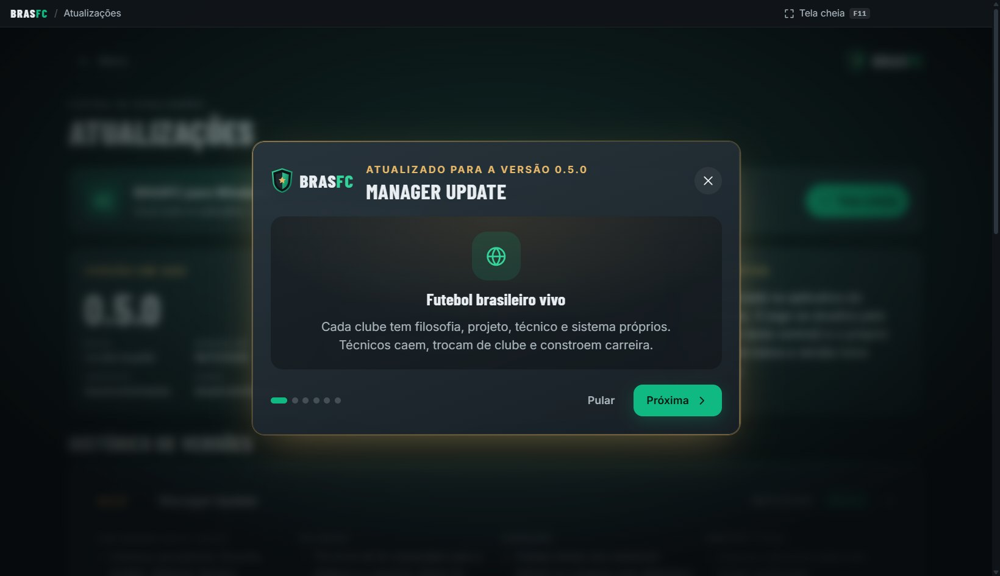
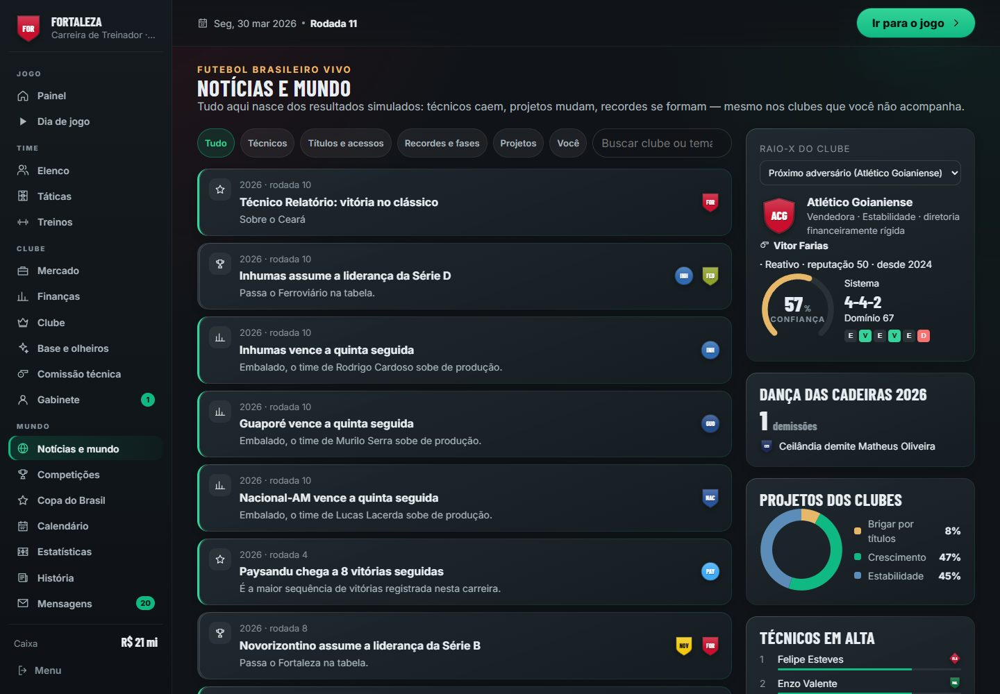
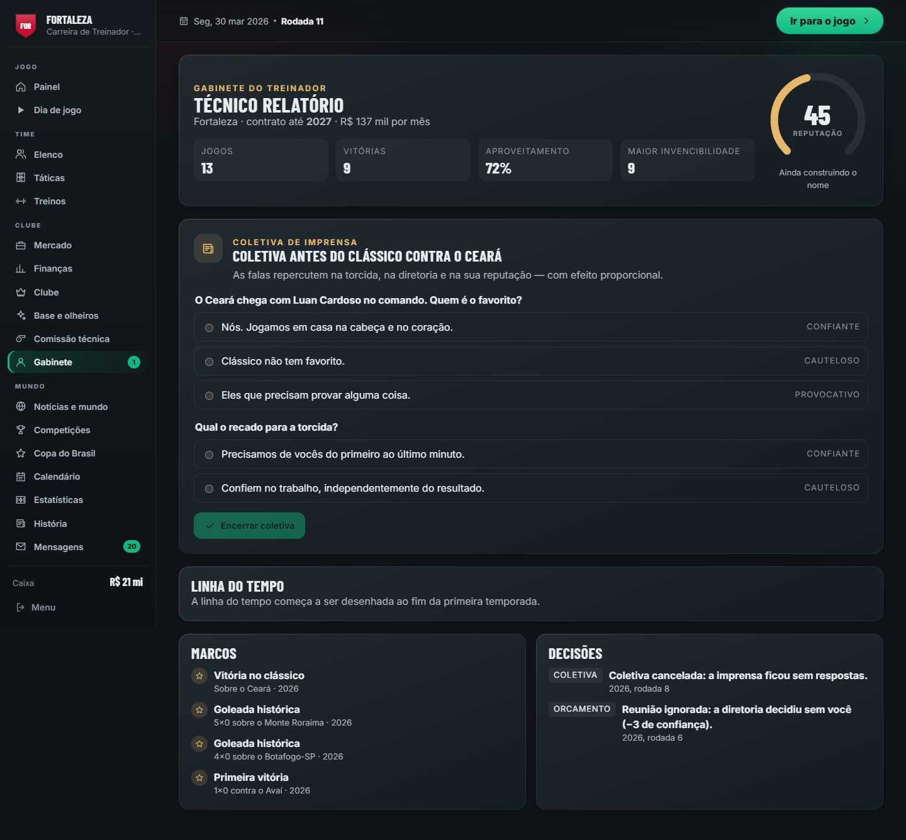
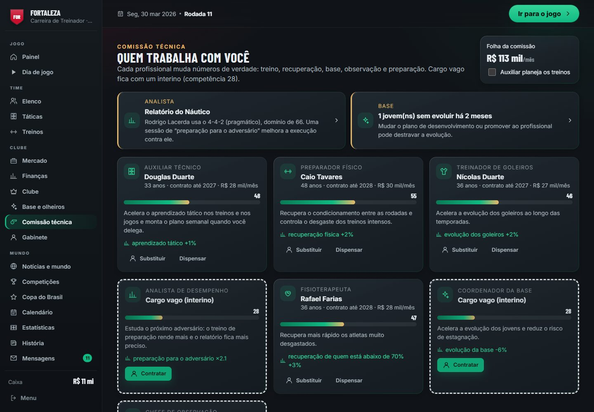
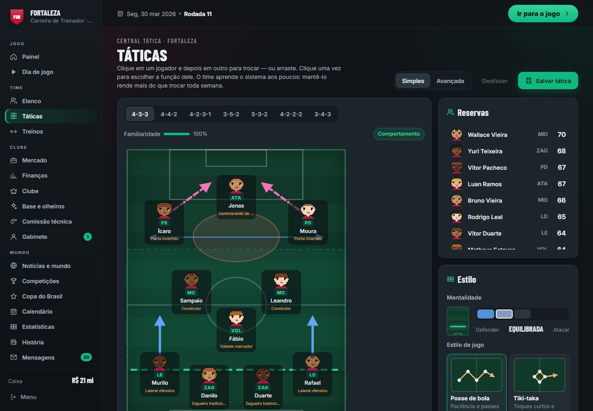
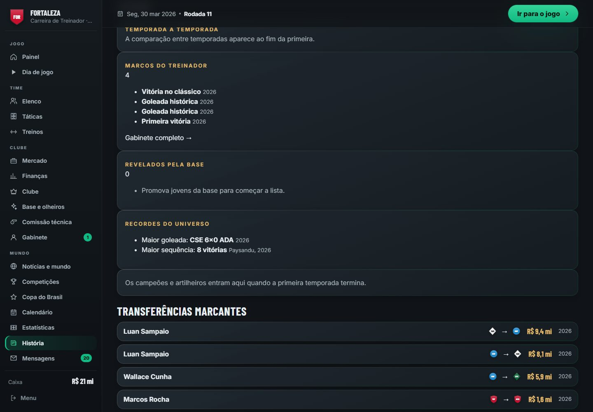

# BRASFC 0.5 — Manager Update

**Relatório das Devs 0.4.1 e 0.5** · 18/11/2026 · versão 0.5.0 · branch `dev`

## Resumo
A 0.4.1 trouxe o aplicativo para Windows, conferiu os dados da Série D e investigou o 5-3-2 com medições amplas. A 0.5 transforma a carreira de treinador: o futebol brasileiro passa a viver sozinho (clubes com filosofia e projeto, técnicos que caem e trocam de clube, notícias e recordes), o treinador ganha um gabinete com diretoria, imprensa, contrato e legado, e a comissão técnica, os treinos e a base passam a ter efeitos medidos.

## Antes e depois
| | 0.4 | 0.5 |
|---|---|---|
| Clubes da IA | perfil de jogo sorteado por temporada | filosofia, projeto, diretoria, técnico com nome e carreira, sistema e domínio salvos |
| Técnicos | sem nome, sem mercado | demitidos pela confiança da diretoria, contratados pelo porte, trocam de clube entre temporadas |
| Notícias | mensagens do clube | notícias do universo geradas pelos resultados, com filtro e busca |
| Diretoria | confiança e objetivos | reuniões com escolhas e consequências, ultimato, renovação de contrato |
| Imprensa | — | coletivas em clássicos, crises, embalos, reforços e decisões |
| Comissão técnica | — | 7 cargos com competência, salário, contrato e efeito medido |
| Treinos | plano semanal | + preparação para o adversário e planejamento delegado |
| Base | turma e evolução | + plano de desenvolvimento, estagnação, missões com prazo, precisão e comparação |
| Windows | PWA | instalador com janela centralizada, tela cheia e atualização automática |
| Testes | 108 + 44 no navegador | 118 + 56 no navegador |

## Aplicativo para Windows

A janela abre sempre centralizada no monitor onde está o cursor (o tamanho é lembrado; a moldura é corrigida para a escala do Windows). **F11** ou **Alt+Enter** alternam a tela cheia; em tela cheia, um botão discreto aparece ao levar o cursor ao topo. A barra de título é integrada ao visual do jogo. Sem internet, abre uma tela própria que tenta reconectar sozinha. O instalador é gerado e publicado pelo GitHub e o botão **Baixar instalador** só aparece quando ele existe de fato.

## Futebol brasileiro vivo

Cada clube tem diretoria (seis perfis), filosofia (formadora, investidora, vendedora, tradicional, sustentável) e projeto (título, crescimento, estabilidade, reconstrução, crise). A confiança cai com derrotas — mais depressa em sequências ruins e em diretorias imediatistas — e o técnico é demitido quando passa do limite do perfil. O substituto vem do mercado de técnicos, conforme o porte do clube, e chega com o próprio sistema: o time precisa se adaptar. Entre temporadas, rebaixados se reconstroem, promovidos crescem e clubes grandes insatisfeitos buscam técnicos em alta de clubes menores.

| Dez temporadas simuladas (todas as divisões) | Resultado |
|---|---|
| Demissões por temporada | ≈19 |
| Trocas de comando entre temporadas | ≈12 |
| Inconsistências (técnico em dois clubes, clube sem técnico, valores inválidos) | 0 |
| Títulos registrados | 50 de 50 |

## Gabinete do treinador

Reuniões com a diretoria — orçamento, advertência (com promessa de 7 pontos em 5 rodadas), avaliação do meio da temporada e renovação — e coletivas de imprensa com efeito proporcional em torcida, diretoria e reputação. Reunião ignorada por 5 rodadas é decidida pela diretoria, com desgaste. Contrato, reputação, marcos, decisões e linha do tempo da carreira ficam salvos. As propostas de emprego vêm de clubes com vaga ou insatisfeitos e respeitam a reputação.

## Comissão técnica e treinos

| Cargo | Efeito medido |
|---|---|
| Auxiliar técnico | aprendizado tático 0,94×–1,18× (interino a excelente) |
| Preparador físico | recuperação física 0,95×–1,13× |
| Fisioterapeuta | recuperação de quem está abaixo de 70% 0,98×–1,19× |
| Analista | preparação para o adversário (teto de +6 de execução em um jogo) |
| Coordenador da base | evolução dos jovens 0,94×–1,18× |
| Chefe de observação | margem dos relatórios menor |
| Treinador de goleiros | evolução dos goleiros |

Com o treino delegado, o auxiliar monta a semana a partir do domínio, do entrosamento, da condição física e do material do analista.

## Domínio tático

O domínio já era progressivo desde a 0.3 (formação, estilo, instruções, entrosamento e funções). Agora a tela mostra a execução jogo a jogo, quantos atletas dominam uma função e quantos jogos levaria para adaptar o time a outro esquema. Os clubes da IA também aprendem e esquecem sistemas, e a troca de técnico obriga a adaptação.

## Base, olheiros e legado

Cada jovem pode ter um plano (técnico, físico, tático, finalização ou equilibrado), que especializa os atributos. Quem passa dos 19 anos sem subir ao profissional evolui menos. As missões dos olheiros têm prazo, os relatórios informam a precisão e é possível comparar até três prospectos. No legado aparecem a comparação entre temporadas, os jovens revelados (com o nível de hoje) e os recordes do universo.

## 5-3-2 (0.4.1)
| Contra o 4-3-3, 400 jogos por linha | Pontos por jogo |
|---|---|
| 4-3-3 (espelho) | 1,41 |
| 4-4-2, posse | 1,10 |
| 5-3-2, posse | 1,07 |
| 5-3-2, defensivo + contra-ataque | 1,27 |

A causa principal não é a defesa (o 5-3-2 cede chances de menor qualidade que o 4-3-3), e sim a criação: esquemas com dois atacantes e sem pontas finalizam cerca de 9 vezes por jogo com posse, contra 13 do 4-3-3. Foram testados cinco ajustes no motor (alas mais altos, atacantes nos corredores, zagueiro de cobertura, compactação do bloco, segundo atacante na área); todos pioraram o resultado ou ficaram dentro do ruído e foram descartados, então o motor segue idêntico ao da 0.4. O auxiliar agora recomenda o uso medido do 5-3-2.

## Desempenho
| | 0.4 | 0.5 |
|---|---|---|
| Partida no motor (mesma máquina, lado a lado hoje) | 186 ms (0.4.0) | 189 ms — sem diferença; o motor é o mesmo (impressão digital idêntica). A referência de 132 ms foi medida com o computador mais livre |
| Passo de domingo (dev) | ≈1,9 s | 1,9–2,0 s (primeiro passo de save antigo: ≈2,5 s, cria o universo) |
| Quarta de Copa sem o usuário | ≈27 ms | 32–35 ms |
| Navegação interna | 52–81 ms | 42–104 ms |
| Memória da página | ≈96 MB | ≈108 MB |
| Dez temporadas do universo (sem banco) | — | ≈8 s |

## Testes
- 118 testes automáticos (eram 108), incluindo dez temporadas do universo com invariantes, efeitos medidos da comissão e dos treinos, gabinete, propostas coerentes e temporada completa pelo servidor com saldo conferido e universo/gabinete salvos.
- 56 verificações no navegador real: telas novas, reuniões, comissão, treino delegado, plano da base, missões, recusas de dados inválidos e responsividade.
- Autoteste do aplicativo do Windows: janela centralizada, entrada e saída da tela cheia, página carregada.

## Pendências
- **Elencos e técnicos reais:** sem fonte verificável e licenciada; continuam fictícios e identificados.
- **Criação de chances dos esquemas com dois atacantes:** estrutural no motor; exige uma revisão do último terço.
- **Série C 2028:** 2ª fase ainda sem regulamento; segue como projeção marcada.
- **Instalador sem assinatura digital paga:** o Windows pode pedir confirmação na primeira execução.
- **Memória:** +12 MB com o universo carregado no navegador.

## Recomendações para a Dev 0.6
1. Revisar a criação de chances no último terço (duplas de ataque, cruzamentos, segundo atacante), medindo com 400+ jogos por configuração.
2. Carregar o universo sob demanda (só notícias e o clube em foco) para reduzir memória e o tamanho do save.
3. Assinar o instalador e publicar a versão estável na branch `main`.
4. Conferir elencos reais quando houver fonte licenciada.
