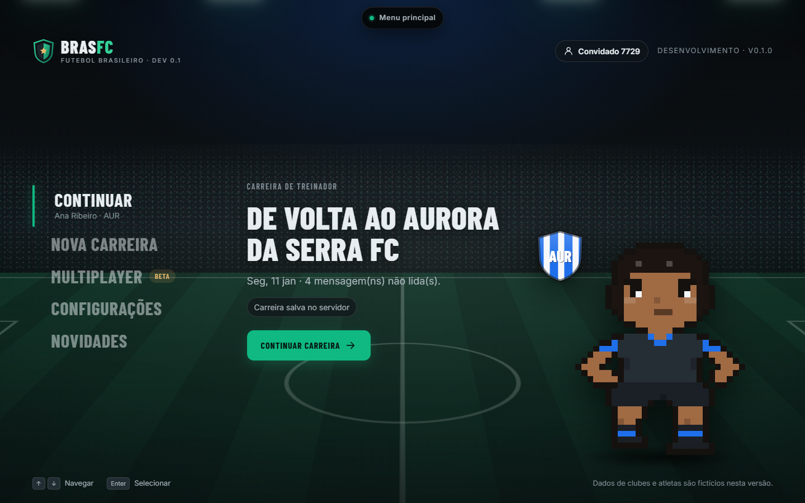
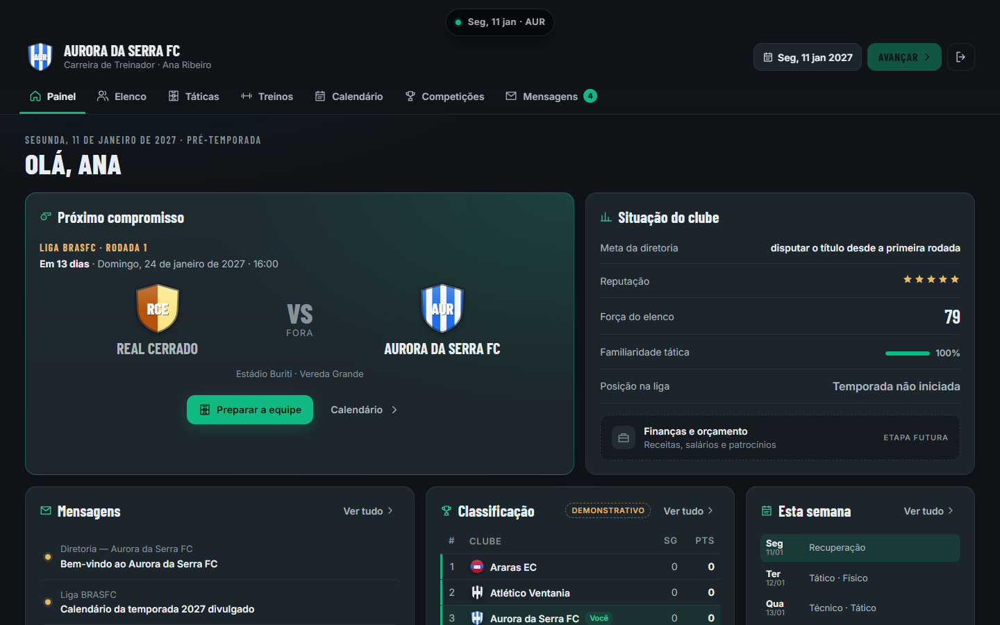
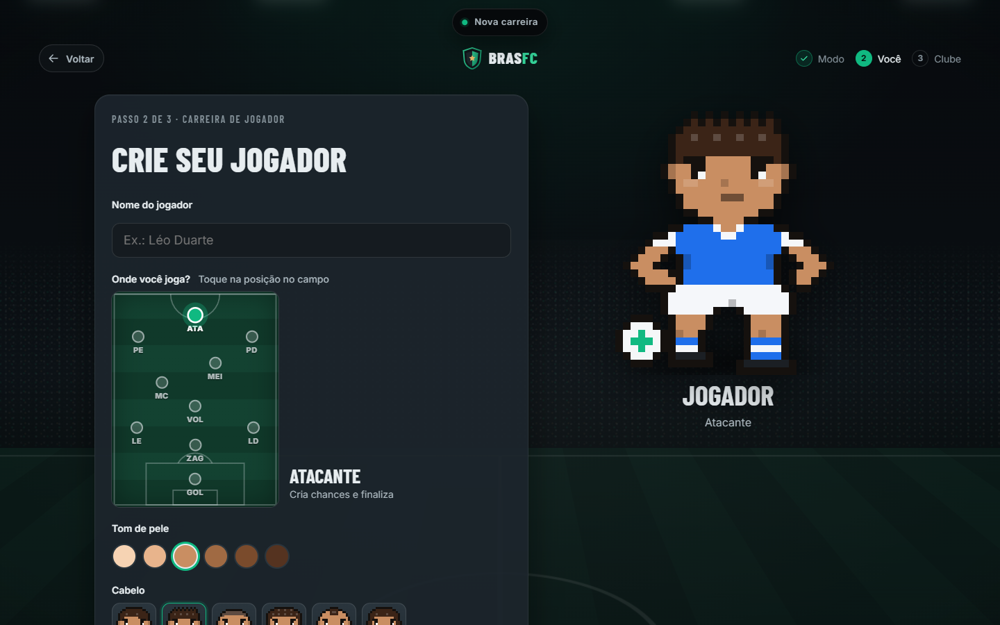
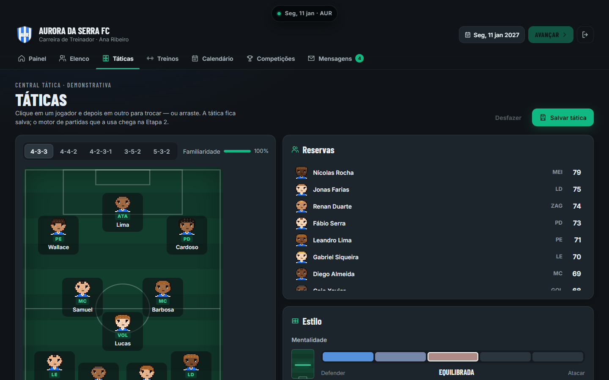

# BRASFC — Relatório da Etapa 1 (Dev 0.1)

**Data:** 17/11/2026 · **Versão:** 0.1.0 · **Branch:** `dev`

## Resumo

O BRASFC agora é uma aplicação web executável, navegável e salva no servidor: abertura, menu cinematográfico, criação de carreira de Treinador ou Jogador, central da carreira completa (com dados fictícios identificados), multiplayer beta com salas em tempo real e toda a infraestrutura de publicação pronta. Nada complexo foi simulado como se funcionasse: o que ainda não existe aparece como "Próximas etapas" ou "Demonstrativo".

## Verificações executadas

| Verificação | Resultado |
| --- | --- |
| `svelte-check` (tipos e Svelte) | 0 erros, 0 avisos |
| Testes automatizados (`vitest`) | 31 de 31 passando — domínio, banco (PostgreSQL via PGlite), WebSocket com dois jogadores, segurança |
| Build de produção | ok |
| Servidor de produção + `scripts/smoke.mjs` | saúde, sessão, bloqueio CSRF, carreira, sala e presença por WebSocket: ok |
| Revisão visual (Edge headless, 1440×900 e celular 390×844) | sem rolagem horizontal; telas conferidas |
| Imagem Docker | **não testada localmente** (Docker não está instalado nesta máquina); é construída no CI |
| Deploy público | **não realizado** — faltam VPS, domínio e credenciais (ver abaixo) |

## Capturas

| Menu principal | Painel da carreira |
| --- | --- |
|  |  |
| **Criação do jogador** | **Central tática** |
|  |  |

## O que funciona

**Telas**
- **Abertura** — carregamento real (motor de animação, fontes, sessão no servidor, código e dados do menu), barra de progresso, pular com clique/Enter/Esc, erro com "Tentar de novo".
- **Menu principal** — estádio noturno original em camadas, personagens em pixel art, indicador líquido, navegação por setas/Enter e mouse; Continuar, Nova carreira, Multiplayer, Configurações, Novidades.
- **Nova carreira** — Treinador × Jogador lado a lado com diferenças claras; nome; **posição escolhida no campinho**; pele, cabelo (miniaturas em pixel art) e cor com prévia ao vivo; 20 clubes com escudo, reputação e meta da diretoria; apresentação cinematográfica pulável.
- **Continuar** — cartões das carreiras salvas, exclusão com confirmação.
- **Central da carreira**
  - Painel: próximo compromisso, situação do clube/seu jogador, mensagens, classificação, semana, notícias, atalhos.
  - Elenco: tabela ordenável e filtrável, ficha do atleta, goleiros com uniforme próprio.
  - Táticas (treinador): 5 formações, trocar por clique ou arrastar, familiaridade calculada, mentalidade em escala visual, estilo em cartões com mini-diagramas, relatório do auxiliar baseado em regras, **salvar com proteção contra sair sem salvar**.
  - Treinos: quadro semanal visual; ênfase do time (treinador) ou foco individual (jogador), salvos no servidor.
  - Calendário: mês com escudos dos adversários; Competições: tabela completa e rodadas.
  - Mensagens: importantes destacadas, leitura salva no servidor.
- **Multiplayer (beta)** — criar sala, entrar por código, presença online/offline e "pronto" em tempo real, anfitrião encerra a sala; recursos futuros listados como indisponíveis.
- **Configurações** — animações (automático/completo/reduzido), desempenho visual, tamanho do texto, abertura, nome do perfil.
- **Novidades** — versão, commit, ambiente e verificação de atualização.

**Base técnica**
- SvelteKit 3.2 + Svelte 5 + TypeScript + Vite 8 (HMR); Node; PostgreSQL com migrações; WebSocket autoritativo.
- Design system: tokens com a paleta pedida (#101418, #1C252B, #10B981, #E7EDF0, #E8B86A), Barlow Condensed + Inter auto-hospedadas, painéis, botões, modais, abas, medidores, ícones próprios, Dynamic Island.
- Ultra Motion X integrada (molas, transições de página, Dynamic Island, indicador líquido, microinterações, partículas) — ver [docs/ULTRA-MOTION-X.md](docs/ULTRA-MOTION-X.md).
- Acessibilidade: navegação por teclado, foco visível, ARIA, movimento reduzido, texto ampliável.
- Segurança: CSP com nonce, verificação de origem, limites de taxa, cookies seguros, tokens com hash, validação no servidor.
- Atualizações: aviso de nova versão que respeita alterações não salvas; `/api/health` e `/api/version`.

## Dados demonstrativos

Clubes, atletas, notícias e tabela são **fictícios** e marcados na interface. A tabela está zerada porque nenhuma partida foi disputada. Nenhum elenco ou marca oficial foi usado.

## O que ainda falta (próximas etapas)

- Motor de partidas e **avanço do calendário** (botão "Avançar" desativado com explicação).
- Finanças, patrocínios, estádio, base, olheiros, comissão técnica, auxiliar humano/IA.
- Carreira de jogador: contratos, empresário, imprensa, reputação, titularidade dinâmica.
- Multiplayer: carreiras compartilhadas, técnico + auxiliar, propostas, calendário sincronizado.
- Contas com login (hoje: perfil de convidado por cookie neste navegador).
- Personalização completa do personagem; simulação 2D (PixiJS a avaliar).
- Testes de interface ponta a ponta automatizados (Playwright) no CI.

## Como executar

```bash
npm install
```

```bash
npm run dev
```

Abra http://localhost:5173 (não precisa de Docker; os dados ficam em `./data/pglite`).

## Como publicar

Siga [docs/DEPLOY.md](docs/DEPLOY.md). Resumo: preparar a VPS com Docker, criar os arquivos `.env` na VPS, subir o Caddy, cadastrar os secrets `VPS_HOST`, `VPS_USER`, `VPS_SSH_KEY`, `VPS_KNOWN_HOSTS` e a variável `PUBLIC_URL` no GitHub. Depois disso, cada push em `dev` publica em staging e cada merge em `main` (com aprovação) publica em produção, com backup e retorno automático se a versão nova falhar.

**Dados necessários de você:** domínio(s), IP/host da VPS, usuário SSH, chave de deploy e e-mail para o certificado HTTPS.
